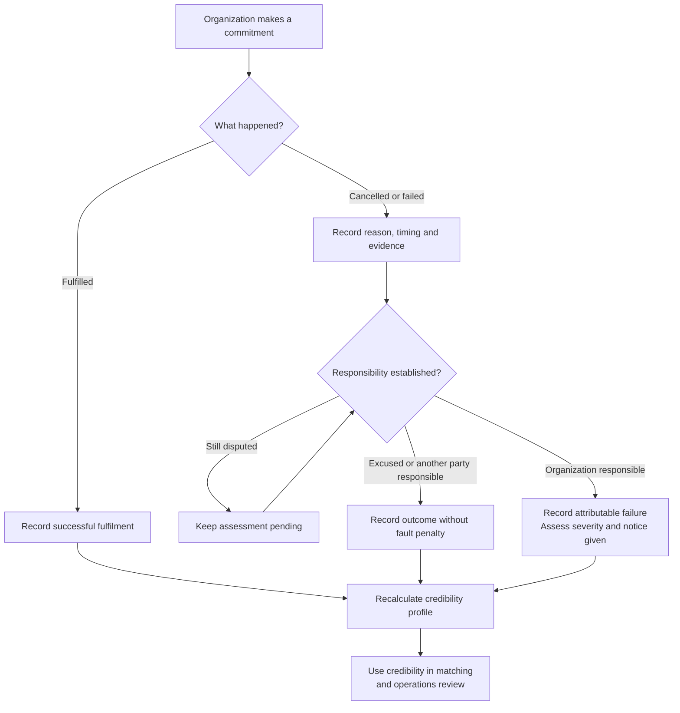

# Credibility system

Recorded on 2026-10-09 after Aryan requested a credibility system for transporters, exporters and importers and accepted the proposed direction.

Status: agreed domain direction. The entity names below are working proposals. No scoring formula, numerical weights, restriction thresholds or implementation have been approved.

## Purpose

Track how reliably an organization fulfils its commitments. Cancellations, withdrawals and other attributable failures affect its credibility alongside successful fulfilment.

Use `credibility` or `reliability` in the model. Keep this separate from financial credit, wallet balances and permission to pay later.

## Agreed principles

- Store the history behind the score. Calculate the current profile from that history.
- Scope credibility to an organization and its role. An organization acting as both importer and transporter can have different reliability in each role.
- A cancellation starts an assessment. It does not automatically subtract points.
- Record the reason, timing, evidence and responsible party before applying a fault penalty. Keep disputed responsibility pending.
- Distinguish early withdrawal from withdrawal after payment or after a truck arrives. Consider notice and operational impact.
- Include fulfilled commitments. One cancellation in 200 commitments differs from one in two.
- Account for recency and allow successful work to rebuild credibility. The weighting and recovery period remain open.
- Show insufficient history for new organizations, with their completed commitment count. Do not imply an established record by assigning an initial score of 100.
- Prevent duplicate scoring of the same failure for the same organization's commitment.
- Keep financial penalties and credibility assessments separate. Both can reference the same service issue; neither automatically determines the other.

## Proposed records

| Entity | Responsibility | Information to retain |
|---|---|---|
| `credibilityEvents` | Record fulfilled commitments and assessed failures | Organization, role, related commitment and booking or availability, outcome, timing, reason, evidence, responsibility assessment and assessment author |
| `credibilityProfiles` | Summarize current credibility for an organization in a role | Current score or insufficient-history state, completed commitment count, cancellation rate, assessment period and scoring-policy version |

The profile is a calculated summary. Event history remains available to explain the result and recalculate it when policy changes. Exact fields and storage structure will be settled with the schema.

Link transporter events to the relevant transport assignment, exporter events to the affected booking or job commitment, and importer events to the committed container availability. Link failures to the service issue that establishes what happened and who was responsible.

## Assessment flow

An excused cancellation can remain visible in the history without receiving an attributable-failure penalty. How each outcome contributes to displayed rates and the numerical score remains a policy decision.

## Examples

These companies and scenarios are fictional. No numerical score changes are implied.

| Organization and role | Event | Treatment |
|---|---|---|
| Deccan Roadlines, transporter | Accepted JOB-101, then withdrew after Sahyadri paid | Record an attributable withdrawal after payment. Assess notice and operational impact. |
| Sahyadri Auto Components, exporter | Cancelled after Konkan's truck reached the factory | Record cancellation after arrival, including arrival evidence and the reason. Assess responsibility. |
| Waluj Precision Castings, importer | Committed an empty container for reuse, then gave it to another operator | Record withdrawal of committed availability and link the affected fulfilment plan. |
| Sahyadri Auto Components, exporter | Rejected a container after inspection found a damaged floor | Investigate responsibility. Do not automatically penalize the exporter for rejecting unsuitable equipment. |
| Konkan Transport, transporter | Completed its accepted job within the agreed conditions | Count successful fulfilment toward its reliability history. |

## Relationship to money and matching

The charge records an amount owed. The credibility event records behaviour and its assessment. A settlement or payment transaction records entitlement or money movement, not the credibility score.

A service issue can therefore produce a financial adjustment, a credibility assessment, both or neither, depending on the evidence and applicable policy.

Credibility can inform matching and operations review. The earlier [build decisions](06-build-decisions.md#cancellations-and-late-arrivals) already describe temporarily reducing a transporter's matching rank after cancellation. This model supplies the supporting history; it does not set the reduction, its duration or automatic restrictions.

## Policy still to decide

- Which commitments and outcomes count for each role, and the denominator for displayed cancellation rates.
- Numerical weights for timing, responsibility, notice and operational impact.
- Minimum history needed to publish a score, recency weighting and recovery periods.
- Who can assess responsibility, resolve disputes and correct an assessment, with the correction history preserved.
- How credibility changes matching priority, when operations reviews an organization and whether any restrictions apply.
- Who can see the score and its underlying history.

The [implementation question register](07-implementation-questions.md) retains the broader unresolved liability and exception-handling decisions. Saving this credibility model does not resolve those policies.
