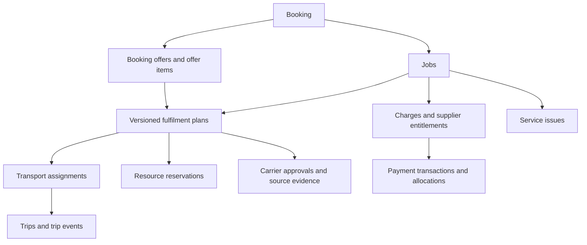

# Database model review for Hitesh

## What this review covers

We are designing an on-demand container transport platform. The customer requests transport; the platform arranges sourcing, transporter acceptance and required carrier approvals before presenting a payable offer.

This note preserves the current architecture direction, the domain model Aryan liked in the prior Codex discussion, and six logical gaps identified in the subsequent review. It is a discussion document, not an approved schema or implementation plan. No application or database behavior has been verified by this review.

**The central design stays:** keep the customer's transport requirement intact while allowing the fulfilment arrangement to change. Replacing a truck, transporter or container should not recreate the booking or overwrite its accepted price and execution history.

## Source and decision precedence

- Original domain-model discussion: Codex thread `01a11ef7-eeb1-71d3-abbf-18724c56a054`, accessible in Codex as `codex://threads/01a11ef7-eeb1-71d3-abbf-18724c56a054`.
- In that thread, Aryan rejected the premature backend-first milestone and generic entity list, then endorsed the revised fulfilment-plan model and concrete table examples. This note summarizes those examples so the review does not require access to the local thread.
- [Implementation questions and later booking decisions](07-implementation-questions.md) distinguish accepted policies from recommendations and open questions.
- [Build decisions](06-build-decisions.md) contain older decisions, some superseded by later discussion.
- The [booking-core milestone](../.plannotator/booking-core/plan.md) remains a historical proposal. Aryan rejected it as the immediate direction in favor of working through the business loop and entities first. Its presence on disk is not approval to implement it.
- The stack simplification below was agreed in the follow-up conversation. The six corrections remain review recommendations, not approved commercial rules.

The requested Claude Opus 5.5 cross-review has not happened because the requested model was unavailable in the session. This is a single-model reasoning review. An additional repository-wide cross-check failed, so the findings are not a claim that every earlier discussion omitted these concerns. No private transcript export is included.

## Agreed stack direction

| Technology | Intended responsibility |
| --- | --- |
| Convex | Authoritative application database, backend functions, transactional mutations and realtime subscriptions |
| Next.js on Vercel | Customer, transporter, carrier and operations web applications |
| Expo | Driver application, including explicitly designed offline persistence and synchronization |
| Better Auth | Authentication; domain permissions still belong in backend authorization checks |
| Effect | Integration workflows and typed failure handling where useful |
| Razorpay | Payment provider; product suitability, funds flow and tax treatment require confirmation before live money |
| R2 | Private documents and trip evidence, with authorized metadata in the database |

Drizzle and Elysia are not part of the initial architecture. We are not introducing a second transactional database or separate API service without a concrete responsibility that requires one.

Convex's reactive updates do not define the business state machines. We still implement valid transitions and cross-record invariants. External payment calls are not atomic with database mutations. Realtime connectivity also does not replace a durable offline driver queue.

## Existing model we are reviewing

| Records | Meaning |
| --- | --- |
| `bookings`, `jobs` | The overall customer request and one independently fulfilled requirement per container |
| `fulfilmentPlans` | Versioned ways to fulfil a job, including reuse or depot sourcing and planned movements |
| `containerAvailability` | A particular availability occurrence for a physical container, not the container itself |
| `transportAssignments` | Transporter acceptance, compensation and resource assignment history |
| `carrierApprovals` | Permission for a specific reuse arrangement, with conditions and evidence |
| `bookingOffers`, `offerItems` | The jobs, arrangements and prices presented to and accepted by the customer |
| `resourceReservations` | Claims on equipment, separating unpaid hold expiry from the actual usage window |
| `trips`, `tripEvents` | Actual execution, including successor movements and reported events |
| `charges` | Financial obligations, with payer, recipient and reason |
| `paymentTransactions`, `transactionAllocations` | Collection, refund or payout attempts and how amounts apply to charges |
| `settlements` | Transporter entitlement, release eligibility and payout status |
| `serviceIssues` | Exceptions requiring an owner, decision and resolution |

Supporting records include organizations, users, memberships, drivers, vehicles, containers, locations and documents. Exact table boundaries and field definitions are still proposals.

### Original example

One exporter books two 40ft containers from Waluj to JNPT:

- `J1` uses reuse plan `P1`, accepted by FLEET_A. Illustrative customer freight is ₹22,000 plus a ₹1,000 platform fee.
- `J2` uses depot plan `P2`, accepted by FLEET_B. Illustrative customer freight is ₹30,000 plus a ₹1,000 platform fee.
- Offer `OF1` totals ₹54,000, with an immutable offer item for each job.
- Collection `TX1` allocates that amount across four charges.
- Each job has its own transporter settlement.
- If FLEET_A withdraws, J1 stays intact while replacement plan `P3` and a new assignment are selected. The original accepted offer remains unchanged.

Amounts are examples, not commercial rates. Customer freight and supplier compensation are separate values even when the example makes them equal. Storage is intended to use integer paise.

## Six logical gaps

### 1. Replacement can leave charges naming the old transporter

**Scenario.** Charge `C1` says the customer owes FLEET_A ₹22,000. The collection allocation references C1, and settlement S1 gives FLEET_A that entitlement. FLEET_A withdraws and FLEET_C takes over.

Updating the assignment and settlement alone leaves C1 pointing at FLEET_A. Editing C1 in place rewrites what the original payment covered. Leaving it unchanged without an explicit adjustment makes charges and settlements disagree.

**Recommendation.** Distinguish customer charges from supplier obligations. Link both to the job, but do not assume they are the same obligation.

If the transporter is legally the direct seller to the customer, replacement needs explicit financial adjustments that preserve that commercial relationship. The platform cannot choose who owes whom through convenient field names. Confirm this with the team and CA before finalizing the financial schema.

**Check.** Replace a transporter after collection. Every customer charge, supplier entitlement, allocation and adjustment must still explain its counterparty and amount without rewriting the original agreement.

### 2. Replacement must not erase entitlement for work already performed

**Scenario.** FLEET_A collects the container and performs part of the movement. Its truck breaks down. FLEET_C completes the job.

The earlier withdrawal example was before pickup. Automatically reversing A's full settlement may erase compensation for work performed. Retaining its full entitlement and adding another full settlement may overstate the obligation.

**Recommendation.** Supplier obligations should reference the relevant assignment or agreed work, not just the job and transporter. Preserve the interrupted and successor trips. Replacement itself must not automatically determine partial compensation, penalties or liability.

**Check.** Complete one job through two transporters. Preserve both execution histories and represent approved compensation for each without assuming either full forfeiture or two full freight payments.

### 3. Several records can disagree about the active plan

**Scenario.** The job has `activePlanId`; plans also have a selected status; offers, reservations and trips reference plans. Operations selects P3 while a delayed dispatch command still targets P1.

Without one authority and guarded transitions, we can dispatch the withdrawn transporter after selecting its replacement.

**Recommendation.** The job's active plan authorizes new execution. Accepted offer items remain historical commercial records. Existing trips retain the plan under which they actually started. Replacement activation and changes to affected resource claims must be atomic. Dispatch must validate the current plan and assignment when it commits.

Do not rewrite an existing trip to suggest it always belonged to the replacement plan. In-progress handover needs an explicit transition rather than treating an active-plan pointer change as physical completion.

**Check.** Race replacement activation against dispatch from the old plan. An obsolete command must not create an unauthorized new trip or release the replacement's resources.

### 4. Availability exclusivity can still double-book one physical box

**Scenario.** An importer and an operator independently create AV1 and AV2 for the same physical container CONT1. Booking A reserves AV1 and booking B reserves AV2.

Each availability record has only one reservation, but the physical container is double-booked.

**Recommendation.** Availability describes the sourcing opportunity. Exclusive claims must also protect the canonical physical container over the relevant period. Physical identity rules must prevent duplicate container records from bypassing that protection.

This preserves the useful distinction between a container and its availability occurrences. It connects their uniqueness and reservation rules.

**Check.** Create two availability reports for the same box and attempt overlapping reservations. At most one exclusive claim may succeed. Successive non-conflicting uses must remain possible.

### 5. One return deadline cannot describe changed reuse obligations

**Scenario.** Availability holds an import-side return deadline. The job has an export port cutoff. Carrier permission changes the original return obligation under specific conditions.

If matching continues enforcing the original deadline after that obligation changes, it may reject valid fulfilment. If we overwrite the original deadline with the export cutoff, we lose what the importer originally owed and what authorization changed it.

**Recommendation.** Preserve deadlines with their purpose and source. Record which approval changes which obligation rather than using one mutable deadline for both empty return and loaded export gate-in. Do not assume every reuse approval automatically discharges the importer's obligation.

**Check.** Apply a conditional reuse approval. Show both the original obligation and the currently applicable conditions without treating the export cutoff as an empty-return deadline.

### 6. Mutable requirements can invalidate approvals without breaking references

**Scenario.** Plan P1 and an approval reference job J1. Someone changes J1's shipping line, export booking reference or loading window. Every foreign key still resolves, but the approval and offer may concern the previous requirement.

Versioned plans alone do not protect against a requirement changing underneath them.

**Recommendation.** Once commitments exist, material requirement changes need an explicit revision or amendment. Plans and approvals should identify the requirement version they were evaluated against. Define which changes invalidate which commitments.

A phone-number correction need not create a full requirement revision. Changing the authorized export movement does. Revisions preserve evidence; they do not by themselves authorize a commercial amendment.

**Check.** Change the export reference after approval. The old approval must not silently authorize the revised job. Preserve the original agreement and require revalidation of affected commitments.

## Review order

1. Establish customer-charge versus supplier-obligation ownership, including partial work.
2. Define atomic replacement activation and stale-command rejection.
3. Enforce resource exclusivity against physical identity, not only availability records.
4. Define material requirement revisions and approval validity.
5. Preserve deadline obligations and the evidence that changes them.

We should keep the existing domain structure. Most corrections concern relationships, authority and transition rules. Financial obligations and requirement revisions may need structural refinement.

## Already discussed, not new discoveries

The earlier discussion already covered container suitability, custody evidence, importer return obligations, customer price versus supplier cost, offline occurrence versus receipt time, exception ownership, and separate completion, dispute and payout states. This review does not present those subjects as newly discovered requirements.

Other policies remain open in the question register: specific-truck versus capacity commitment, driver assignment timing, import-data ownership, exact partial-booking behavior, payment-processing duration, gate-in verification and liability. Broad approval of the entity examples did not settle each policy.

## Suggested discussion with Hitesh

Start with one paid job whose transporter is replaced after pickup. Walk through the original customer agreement, completed work, successor trip, resource claims, supplier entitlements and payment allocations. Then change the export booking reference and check which permissions must be renewed.

The review succeeds when those histories remain explainable without deleting facts, silently increasing customer charges, or allowing two parties to use the same resource. Implementation and live payment approval remain separate steps.
